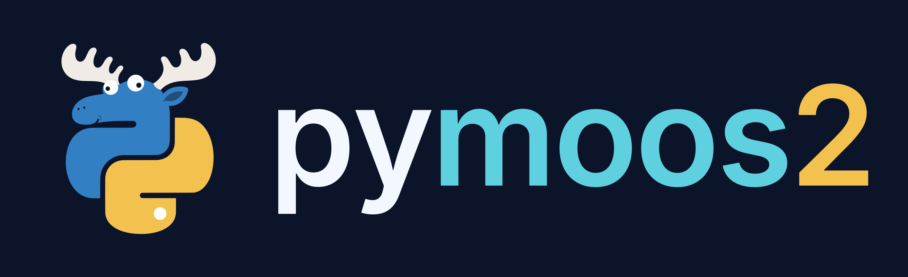

<p align="center">
  
</p>

# pymoos2

Write [MOOS-IvP](https://oceanai.mit.edu/moos-ivp) applications in Python.
pymoos2 speaks the native MOOSDB protocol, so Python apps run beside C++ apps
under pAntler, appcast to uMAC and pMarineViewer, and read the same `.moos`
mission files.

```bash
pip install pymoos2
```

Python 3.8 or newer.

## A first app

```python
from pymoos2 import AppCastingMOOSApp, ACTable, run


class Doubler(AppCastingMOOSApp):

    def on_startup(self):
        self.gain = self.config("gain", default=2.0, type=float)
        self.nav_x = 0.0

    def register_variables(self):
        self.register("NAV_X")

    def on_new_mail(self, mail):
        for msg in mail:
            if msg.name == "NAV_X":
                self.nav_x = msg.double()

    def iterate(self):
        self.notify("NAV_X_SCALED", self.nav_x * self.gain)

    def build_report(self):
        table = ACTable(["Variable", "Value"])
        table.add("NAV_X", f"{self.nav_x:.2f}")
        self.report(table)
        return True


if __name__ == "__main__":
    import sys
    run(Doubler, "pDoubler", sys.argv[1])
```

```
ProcessConfig = pDoubler
{
  AppTick   = 4
  CommsTick = 4
  gain      = 3
}
```

Posts go out at the next CommsTick; raise CommsTick for lower latency.

## Building in a moos-ivp tree

Python apps live in `src/` beside the C++ apps and build with the tree's
`./build.sh`. Add this once to the top-level `CMakeLists.txt`, next to
`find_package(MOOS)` (`python3 -m pymoos2 --cmake-block` prints it):

```cmake
#=======================================================================
# Find pymoos2 (Python MOOS apps)
#   Python: -DPYMOOS2_PYTHON, the active venv, ../venv, or python3 on PATH
#=======================================================================
find_program(PYMOOS2_PYTHON NAMES python3 python
             HINTS ENV VIRTUAL_ENV "${CMAKE_SOURCE_DIR}/../venv" PATH_SUFFIXES bin)
execute_process(COMMAND "${PYMOOS2_PYTHON}" -m pymoos2 --cmake-dir
                OUTPUT_VARIABLE PyMOOS2_DIR OUTPUT_STRIP_TRAILING_WHITESPACE ERROR_QUIET)
find_package(PyMOOS2 QUIET)
if(NOT PyMOOS2_FOUND)
  message(WARNING "pymoos2 is not importable with ${PYMOOS2_PYTHON} - Python apps will not be built. "
                  "pip install pymoos2 there, or configure with -DPYMOOS2_PYTHON=<python>.")
  unset(PYMOOS2_PYTHON CACHE)
  function(pymoos2_add_script_app)
  endfunction()
  function(pymoos2_add_package_app)
  endfunction()
endif()
```

Then generate apps in `src/` and add them with `ADD_SUBDIRECTORY`:

```bash
python3 -m pymoos2 --GenAppCastingMOOSApp Foo p "Your Name"   # script app
python3 -m pymoos2 --GenPackageApp Bar p "Your Name"           # package app
```

Each app's `CMakeLists.txt` is one call:

```cmake
pymoos2_add_package_app(NAME pBar PACKAGE pbar)
```

`cmake --install build --prefix <dir>` installs the apps; the prefix can be
moved afterwards.

From the root of a tree, `python3 -m pymoos2 --example` adds three example
apps and a mission that runs them.

## Geodesy

Most IvP helm behaviors use local SI coordinates: meters east and north of
the mission origin. `pymoos2.geodesy` converts with PROJ.

```python
from pymoos2.geodesy import LocalFrame, geodesic, distortion

frame = LocalFrame(42.358456, -71.087589)        # UTM, zone fixed by the origin
x, y = frame.to_xy(42.3601, -71.0942)
lat, lon = frame.to_latlon(x, y)

geodesic.distance(42.36, -71.09, 51.48, 0.0)     # WGS84 meters
distortion(frame, lat, lon)                      # scale and heading error of the flat frame here
```

`LocalFrame(..., projection="aeqd")` suits long ranges and the poles.

## Tests

```bash
git clone https://github.com/raymondturrisi/pymoos2 && cd pymoos2
pip install -e .[test]
./test.sh              # every test, with its result
./test.sh --wheel      # test the built wheel in a fresh venv
```

## License

MIT
